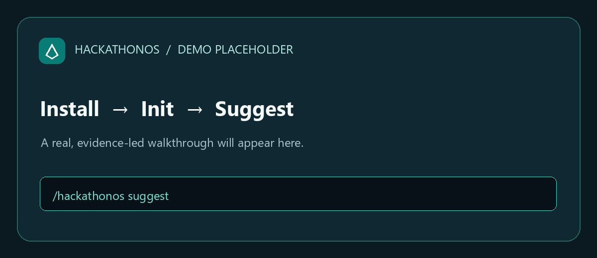

# HackathonOS

**Build the right thing. Prove it works. Show why it matters.**

HackathonOS is a globally installed skill for Claude Code and OpenCode that mentors your work across projects; it is a tool you install once and use in every project, not a hackathon project.

[](LICENSE)
[](https://github.com/Anshkaliya18/HackathonOS/releases/latest)
[](https://github.com/Anshkaliya18/HackathonOS/stargazers)
[](AGENT-COMPATIBILITY.md)

Docs: [anshkaliya18.github.io/HackathonOS](https://anshkaliya18.github.io/HackathonOS/)

<!-- Record the install-to-recommendation walkthrough described in scripts/record-demo.md and save it to docs/public/demo.gif. -->


## Install once

Linux / macOS:

```bash
curl -fsSL https://raw.githubusercontent.com/Anshkaliya18/HackathonOS/v1.0.0/distribution/install.sh | HACKATHONOS_RELEASE_MANIFEST_URL=https://github.com/Anshkaliya18/HackathonOS/releases/download/v1.0.0/manifest.json bash
```

Windows PowerShell:

```powershell
$env:HACKATHONOS_RELEASE_MANIFEST_URL = 'https://github.com/Anshkaliya18/HackathonOS/releases/download/v1.0.0/manifest.json'; irm https://raw.githubusercontent.com/Anshkaliya18/HackathonOS/v1.0.0/distribution/install.ps1 | iex; Remove-Item Env:\HACKATHONOS_RELEASE_MANIFEST_URL
```

After the npm package is published, install with `npx hackathonos-cli install`. Preview target paths without changing files with `npx hackathonos-cli install --dry-run`; remove the global installs with `npx hackathonos-cli install --uninstall`. The package is prepared in this repository but has not been published to npm yet.

## Try it now

```text
/hackathonos help
/hackathonos init
/hackathonos suggest
```

## Why it's different

- **Evidence-led:** recommendations distinguish project evidence from assumptions and unknowns.
- **Human approval gates:** the skill prepares actions and submission materials while leaving consequential decisions to you.
- **Judging impact per unit time and risk:** prioritize work that can improve judging outcomes within your remaining time and constraints.

## Capabilities

- Discover, compare, and red-team project ideas.
- Turn a selected idea into an implementation plan and next actions.
- Review configuration, testing, security, UX, demos, and submissions.
- Prepare judge-facing explanations grounded in project evidence.
- Manage the installed skill with the `hackathonos` CLI.

## Supported agents

| Agent | Status | Notes |
|---|---|---|
| Claude Code | Install verified; runtime check pending | v1.0.0 installed in an isolated Windows profile; entry files and command manifest validated. |
| OpenCode | Install verified; runtime check pending | v1.0.0 installed in an isolated Windows profile; entry files and command manifest validated. |
| Other agents | Not currently supported by the installer | See [compatibility notes](AGENT-COMPATIBILITY.md). |

## Project structure

| Path | Purpose |
|---|---|
| `SKILL.md` | Core mentoring behavior and routing |
| `commands/` | Command definitions and compatibility metadata |
| `core/`, `workflows/`, `rules/` | Shared logic, lifecycle guidance, and safety rules |
| `templates/` | Reusable project artifacts |
| `adapters/`, `.claude/`, `.opencode/` | Agent integrations |
| `distribution/` | Installers, CLI, and release metadata |
| `tests/` | Workflow, command, regression, and installer coverage |

## Documentation

- [Documentation site](https://anshkaliya18.github.io/HackathonOS/)
- [Quickstart](QUICKSTART.md) · [Installation](INSTALLATION.md) · [Agent compatibility](AGENT-COMPATIBILITY.md)
- [Commands](COMMANDS.md) · [Workflows](WORKFLOWS.md) · [Configuration](CONFIGURATION.md) · [Architecture](ARCHITECTURE.md)
- [Troubleshooting](TROUBLESHOOTING.md) · [Contributing](CONTRIBUTING.md) · [Security](SECURITY.md) · [Changelog](CHANGELOG.md)
