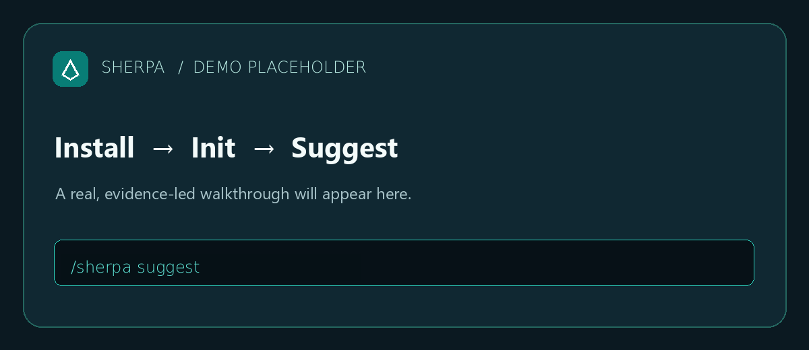

# Sherpa

**Build the right thing. Prove it works. Show why it matters.**

In 30 seconds you get an AI hackathon mentor installed in Claude Code or OpenCode that takes your team from a vague idea to a scoped, evidence-backed plan — and a demo you can defend to judges.

```bash
npm install -g sherpa-skill
sherpa install
```

Then in your agent:
```text
/sherpa suggest
/sherpa plan
/sherpa demo
/sherpa submission
```

**What you get right away:**
- **One install:** works in Claude Code and OpenCode; project state lives in `.sherpa/` and survives restarts and context switches.
- **Evidence-led:** facts vs assumptions, with `UNKNOWN` when information is missing — no invented details.
- **Human approval gates:** Sherpa recommends, never silently picks an idea or writes code without you confirming.
- **Full lifecycle:** idea → plan → build → verify → demo → submission → postmortem.

[](https://www.npmjs.com/package/sherpa-skill)
[](LICENSE)
[](https://github.com/Anshkaliya18/sherpa/stargazers)
[](AGENT-COMPATIBILITY.md)



## Install

The npm package is published as `sherpa-skill` (the name `sherpa` is already taken on npm).

### Option 1: npm (recommended)

```bash
npm install -g sherpa-skill
sherpa install
```

This installs the Sherpa skill for both Claude Code and OpenCode, plus the `sherpa` distribution CLI. To preview without writing files:

```bash
sherpa install --dry-run
```

To install only the skill (skip the CLI):

```bash
sherpa install --no-cli
```

To remove:

```bash
sherpa uninstall
```

The npm `sherpa` launcher supports `install`, `migrate`, and `uninstall`, and forwards `update`, `doctor`, `audit`, `clean`, `help`, and `--version` to the bundled management CLI. Management commands require Python 3.

Install with `--global` to call `sherpa` directly. For a local install, prefix commands with `npx sherpa-skill`, for example `npx sherpa-skill doctor`.

Node.js is required to run the npm package. `package.json` does not declare an `engines` field, so no specific Node version is pinned — use a current LTS release.

### Option 2: Other install methods (release installers)

The release installers download a versioned GitHub Releases archive, verify its SHA-256 checksum, and install the skill and CLI:

macOS / Linux:
```bash
curl -fsSL https://github.com/Anshkaliya18/sherpa/releases/latest/download/install.sh | bash
```

Windows PowerShell:
```powershell
irm https://github.com/Anshkaliya18/sherpa/releases/latest/download/install.ps1 | iex
```

Both installers target `~/.claude/skills/sherpa/` (Claude Code) and `~/.config/opencode/skills/sherpa/` (OpenCode) by default and never touch your project data or `.sherpa/` directories.

## See it in action

The following is an illustrative example, not a guaranteed transcript. It shows how a vague team idea becomes a scoped plan using real `/sherpa` operations.

**Before** — a vague team idea:
> "We should build something for campus accessibility. Maybe an app?"

**After** — walking the idea through Sherpa operations:

```text
/sherpa suggest ideas for campus accessibility
# -> Surfaces candidate ideas with pros/cons, risks, and judging-impact notes.
#    Human picks one; Sherpa never auto-selects.

/sherpa evaluate the chosen idea
# -> Compares candidates against evidence and criteria, then recommends.

/sherpa plan
# -> Writes an implementation-ready engineering plan to .sherpa/.
#    Architecture is not auto-approved and no code is written yet.

/sherpa demo
# -> Produces a judge-oriented demo preparation plan from validated evidence.

/sherpa submission
# -> Verifies and freezes submission materials without submitting.

/sherpa status
# -> Shows where you are, what's complete, what's broken, and the risks.
```

Each operation maps to a real workflow in `workflows/` (e.g. `idea-intelligence.md`, `project-planning.md`, `demo-preparation.md`, `submission.md`) and is registered in `commands/manifest.json`. Invoke as `/sherpa <operation> [focus]`.

## Supported agents

| Agent | Integration files | Global installer | Runtime status |
|---|---|---:|---|
| Claude Code | `.claude/skills/` skill and command files | Yes | VERIFIED |
| OpenCode | `.opencode/commands/` and package metadata | Yes | VERIFIED |
| Kilo Code | `kilo.jsonc`, `.kilo/rules/`, `.kilo/commands/`, `.kilo/skills/` | No | NOT VERIFIED |
| Codex CLI, Qwen Code, Gemini CLI | No verified native adapter | No | Not supported |

Details and evidence: [agent compatibility](AGENT-COMPATIBILITY.md).

Verified status is updated only after runtime testing. The table above reflects integration-file coverage, not confirmed runtime loading.

Help us verify: install Sherpa on your agent, run `/sherpa status` and `/sherpa next`, and open an issue with your results.

## Why Sherpa

- **Evidence-led:** facts, assumptions, and unknowns are kept distinct; `UNKNOWN` is used when information is unavailable.
- **Human approval gates:** recommendations never silently choose ideas or approve consequential work — you confirm each step.
- **Project-local notes:** project context and generated records live in `.sherpa/` inside your repo, not in the skill directory.
- **Full lifecycle coverage:** idea selection → planning → implementation → testing/security → demo prep → submission → postmortem.

## Contributing / Community

- [Contributing guide](CONTRIBUTING.md) — pull requests welcome.
- Look for issues labeled **good first issue**.
- [Open an issue](https://github.com/Anshkaliya18/sherpa/issues) for bugs or verification reports.
- [GitHub Discussions](https://github.com/Anshkaliya18/sherpa/discussions) for questions and ideas.

## Documentation

Field guide: https://anshkaliya18.github.io/Sherpa/ · Project references: [installation](INSTALLATION.md) · [commands](COMMANDS.md) · [workflows](WORKFLOWS.md) · [configuration](CONFIGURATION.md) · [architecture](ARCHITECTURE.md) · [security](SECURITY.md) · [migration](MIGRATION.md) · [contributing](CONTRIBUTING.md) · [changelog](CHANGELOG.md).
