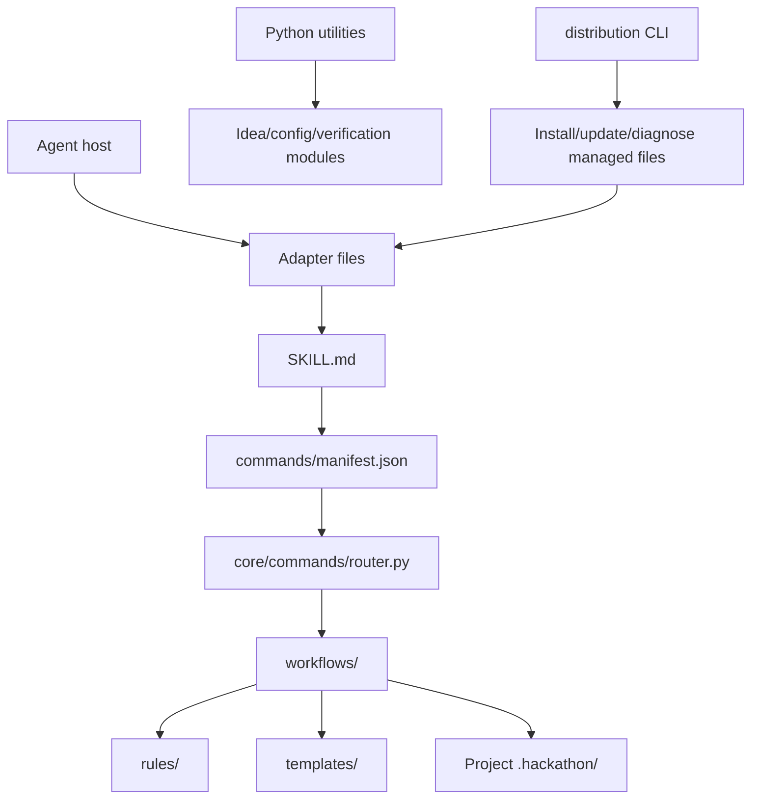
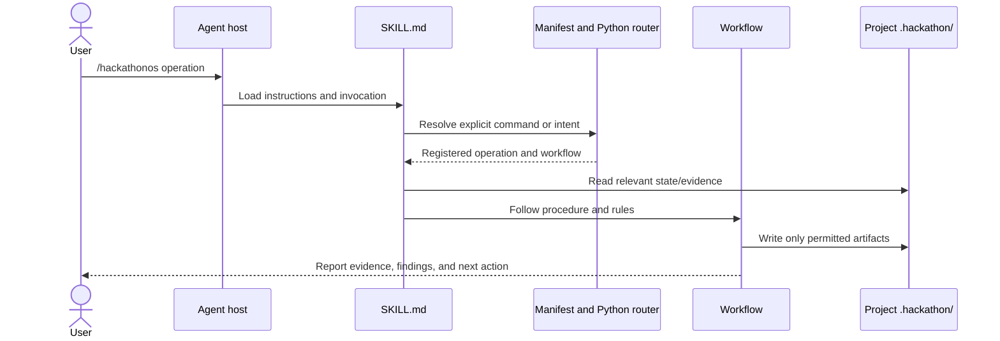

# Architecture

HackathonOS combines agent-readable Markdown with a small Python core and a separate standard-library distribution CLI.

## System view



## Repository map

```text
SKILL.md                    Agent instructions and master router
commands/                   Registered command manifest and command definitions
core/commands/              Command routing
core/configuration/         Configuration manager
core/ideas/                 Idea evaluation engine
workflows/                  Operation procedures
rules/                      Shared behavioral and safety constraints
templates/                  Reusable project artifacts and config examples
src/                        Verification and configuration utilities
adapters/, .claude/,         Host integration assets
.opencode/, .kilo/
distribution/                Installers, CLI, release manifest metadata
tests/, scripts/             Regression checks and evaluation tools
docs/                        This VitePress site and existing source docs
```

## Command execution



## State ownership

Project state belongs to the hackathon repository in `.hackathon/`. The skill's installation directory is reusable and does not hold project state. The distribution CLI explicitly avoids project `.hackathon/` data.

## Routing and extension points

The master behavior is in `SKILL.md`; registered native hyphenated commands and runtime evidence are in `commands/manifest.json`. `core/commands/router.py` implements routing. Workflows, rules, and templates are Markdown extension points. Agent integrations are checked-in assets rather than generated from a central schema.

## Configuration and errors

Configuration handling lives in `core/configuration/manager.py` and `src/config_manager.py`. Release installation checks archive checksums, archive paths, and required skill structure. The CLI has diagnostics and scopes file operations to recognized managed locations. For exact behavior and error recovery, see [installer source notes](https://github.com/Anshkaliya18/HackathonOS/blob/main/INSTALLATION.md), [troubleshooting](/troubleshooting/), and [security guidance](https://github.com/Anshkaliya18/HackathonOS/blob/main/SECURITY.md).
