# Project lifecycle

HackathonOS models work as evidence-backed phases. Use the lifecycle as a map; actual routing and prerequisites are defined in `SKILL.md` and individual workflow files.

```mermaid
flowchart LR
  I[Initialize] --> C[Understand constraints]
  C --> E[Evaluate and select idea]
  E --> P[Plan and approve architecture]
  P --> B[Implement approved tasks]
  B --> V[Test and review]
  V --> R[Red-team, judge, optimize]
  R --> D[Demo and presentation]
  D --> A[Final audit]
  A --> S[Submission readiness]
  S --> M[Postmortem]
```

## How to move through it

1. Initialize project state with `/hackathonos init`.
2. Add challenge requirements, criteria, constraints, and evidence.
3. Explore and evaluate ideas. A human confirms the selection.
4. Create a project plan. A human approves architecture before implementation.
5. Implement approved tasks incrementally, then verify against the plan.
6. Review UX, security, readiness, demo, and presentation as evidence becomes available.
7. Run final audit and submission readiness checks. HackathonOS prepares material; it does not submit it for you.

## Phases and state

Project phase and status are recorded in `.hackathon/project-state.md`. `/hackathonos phase` reads and reports the recorded phase and evidence only. `/hackathonos status` provides a broader evidence-based report; `/hackathonos next` identifies a priority action.

If state or evidence is missing, the skill should report that limitation rather than infer completion from unrelated files. See [workflow inventory](/workflows/).
