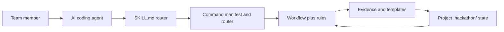

HackathonOS is a Markdown-first mentor skill backed by a small Python core. It focuses teams on **judging impact per unit time and risk**, challenges unsupported claims, and leaves consequential choices to people.

## Start in three steps

1. [Install for Claude Code or OpenCode](/installation/) or open the repository's integration files in your agent.
2. In the project repository, run `/hackathonos help`, then `/hackathonos init`.
3. Check `/hackathonos status` and `/hackathonos next` to understand the current project state and next action.

::: warning Compatibility status
Integration files are present for Claude Code, OpenCode, and Kilo Code, but runtime loading is **NOT VERIFIED** for all three in the command manifest. The global installer targets Claude Code and OpenCode. Codex CLI, Qwen Code, and Gemini CLI do not have verified native adapters.
:::

## How the system fits together

The management CLI is a separate distribution tool. It installs and updates skill files, reports diagnostics, audits managed folders, and can list recognized generated debris for cleanup.

## Pick your path

- **New to HackathonOS:** [Introduction](/getting-started/) → [Quickstart](/getting-started/quickstart) → [First lifecycle pass](/concepts/lifecycle)
- **Installing for a team:** [Installation options](/installation/) → [Agent compatibility](/agents/) → [Configuration](/configuration/)
- **Contributing:** [Architecture](/architecture/) → [Repository map](/architecture/#repository-map) → [Contribution guide](/contributing/)

## Project links

[GitHub repository](https://github.com/Anshkaliya18/HackathonOS) · [Source documentation index](/reference/source-docs)
