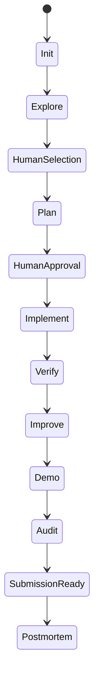

# Workflows

Before you pack, choose the next station from the evidence and time your team actually has. These stops are a map; Sherpa does not advance the project automatically.

Workflows define the purpose, evidence inputs, boundaries, and artifacts for an operation. The canonical procedures live in [`workflows/`](https://github.com/Anshkaliya18/Sherpa/tree/main/workflows); use `/sherpa help` for the live command list.

| Workflow | Purpose | Typical next action |
|---|---|---|
| Init, status, next | Create state, report evidence, prioritize action | Add challenge context or follow the priority |
| Idea intelligence, idea evaluation | Discover and compare ideas | Human selects an idea |
| Project planning | Analyze repository, architecture, and technology choices | Human approves architecture and plan |
| Implementation | Execute approved plan tasks incrementally | Run testing/security review |
| Testing/security, UX review | Record quality findings against available evidence | Route findings to the relevant implementation or planning step |
| Research | Answer a research question with sources | Use evidence in planning or evaluation |
| Red team, judge simulation, score optimization | Challenge readiness, simulate judge perception, prioritize scoring work | Address prioritized evidence gaps |
| Demo preparation, presentation | Prepare an evidence-backed demo and presentation | Verify materials and claims |
| Final audit, submission preparation | Audit consistency and prepare submission materials | Human completes external submission |
| Postmortem | Capture an evidence-based retrospective | Carry lessons into future work |

## Typical path

## Route stations

### Base Camp {#base-camp}

Discover and compare directions with [`/sherpa-suggest`](https://github.com/Anshkaliya18/Sherpa/blob/main/workflows/idea-intelligence.md) and `/sherpa-evaluate`. A person confirms the idea.

### Camp 1 {#camp-1}

Create a repository-aware plan with `/sherpa-plan`; review the [project planning procedure](https://github.com/Anshkaliya18/Sherpa/blob/main/workflows/project-planning.md) and approve architecture before implementation.

### Camp 2 {#camp-2}

Build from approved tasks with `/sherpa-build`, using the [implementation workflow](https://github.com/Anshkaliya18/Sherpa/blob/main/workflows/implementation.md).

### Camp 3 {#camp-3}

Verify and review with `/sherpa-verify`, `/sherpa-test`, or `/sherpa-security` and the [testing and security workflow](https://github.com/Anshkaliya18/Sherpa/blob/main/workflows/testing-security.md).

### High Camp {#high-camp}

Prepare a judge-facing walkthrough with `/sherpa-demo` and the [demo preparation workflow](https://github.com/Anshkaliya18/Sherpa/blob/main/workflows/demo-preparation.md).

### Summit {#summit}

Check readiness and prepare materials with `/sherpa-submission`. The [submission workflow](https://github.com/Anshkaliya18/Sherpa/blob/main/workflows/submission.md) does not submit on your behalf.

The flow is not automatic. Each workflow has its own prerequisites and limits. For example, planning does not write application code, and submission preparation does not submit on your behalf. Read the individual source workflow before changing its behavior.
