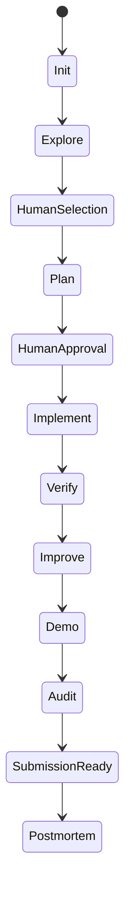

# Workflows

Workflows define the purpose, evidence inputs, boundaries, and artifacts for an operation. The canonical procedures live in [`workflows/`](https://github.com/Anshkaliya18/HackathonOS/tree/main/workflows); use `/hackathonos help` for the live command list.

| Workflow | Purpose | Typical next action |
|---|---|---|
| Init, status, next | Create state, report evidence, prioritize action | Add challenge context or follow the priority |
| Idea intelligence, idea evaluation | Discover and compare ideas | Human selects an idea |
| Project planning | Analyze repository, architecture, and technology choices | Human approves architecture and plan |
| Implementation | Execute approved plan tasks incrementally | Run testing/security review |
| Testing/security, UX review | Record quality findings against available evidence | Route findings to the relevant implementation or planning step |
| Research | Answer a research question with sources | Use evidence in planning or evaluation |
| Red team, judge simulation, score optimization | Challenge readiness, simulate judge perception, prioritize scoring work | Address prioritized evidence gaps |
| Demo preparation, presentation | Prepare an evidence-backed demo and presentation | Verify materials and claims |
| Final audit, submission preparation | Audit consistency and prepare submission materials | Human completes external submission |
| Postmortem | Capture an evidence-based retrospective | Carry lessons into future work |

## Typical path

The flow is not automatic. Each workflow has its own prerequisites and limits. For example, planning does not write application code, and submission preparation does not submit on your behalf. Read the individual source workflow before changing its behavior.
